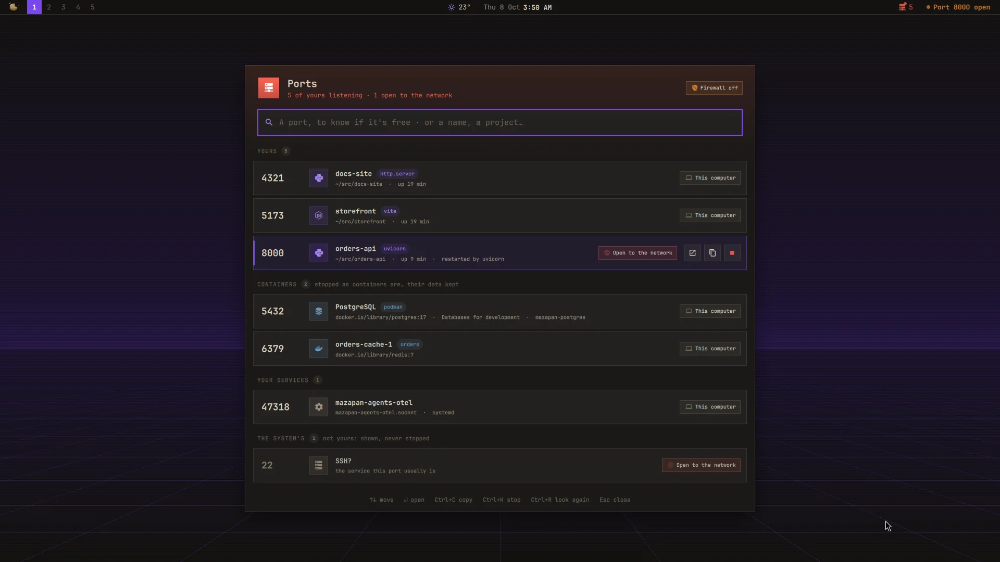
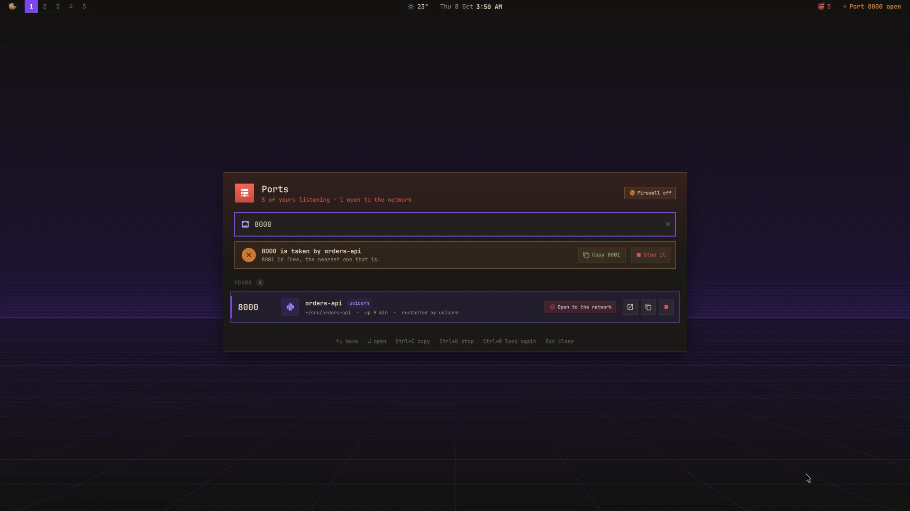
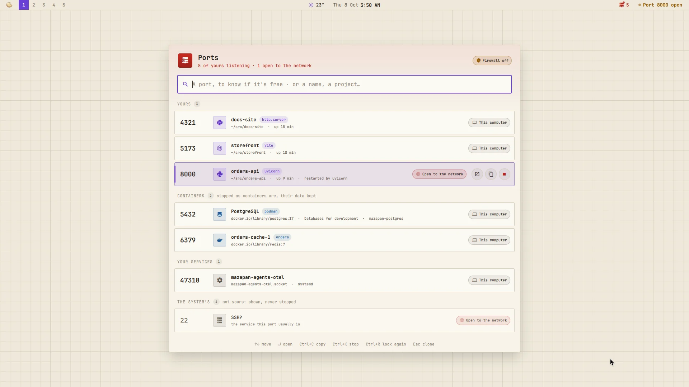

# Ports

A plugin for [Mazapan](https://mazapan.dev), listed in its [plugin registry](https://mazapan.dev/plugins/ports/).



Everything listening on your computer, said the way you'd say it:
not `node` four times, but **storefront**, **orders-api**, **docs-site**,
each with the tool it runs (vite, uvicorn, `dotnet watch`…). For the
moment a server won't start because "the port is already in use", for the
end of a day with things still running you forgot, and for knowing when
something of yours can be reached by anyone on the café's Wi-Fi.

- **Is a port free?** Type it. "3000 is free", or "3000 is taken by
  storefront · 3001 is free", with the free one a click from the
  clipboard. It's asked the way your server will ask: by trying to listen
  there, so what holds it without listening (an outgoing connection) counts
  too, and a port only root may take is said so.
- **Every listener, by name**, in four groups:
  - **Yours**: your servers, with their project (the folder they were
    started from, up to its `.git`, `package.json`, `.csproj`, `Cargo.toml`,
    `go.mod`, `pyproject.toml`…), the tool, how long they've been up, and
    what restarts them, if something does.
  - **Containers**, Podman's (pasta, rootless) and Docker's, by their name
    and Compose project; [Databases for development](https://github.com/rick-dev-creator/mazapan/tree/main/plugins/dev-databases)'
    as PostgreSQL, Redis….
  - **Your services**: systemd sockets of yours, by their unit.
  - **The system's**: root's and other users', shown with the service its
    port usually is (`SSH?`), never stopped from here.
- **How far each one reaches**: *this computer*, *your VPN* (Tailscale,
  WireGuard), *network · firewall* (on every network, but Mazapan's
  firewall keeps it closed), or **open to the network**: the firewall is
  off, or it's Docker, whose published ports go around it.
- **Stop it, for good.** Asked once ("Stop?"), then: your server and what
  starts it again (`dotnet watch`, `uvicorn --reload`, nodemon, `node
  --watch`, cargo-watch…; never the terminal you typed it in); a container
  with `podman stop` or `docker stop`, its data kept; a socket of yours
  with `systemctl --user stop`. Then the port is looked at: free, still
  taken (stop again to force it), or back (something you started restarts
  it: said so).
- **A word when something opens to the network**: one notification, and a
  card in the Control Center with Stop right there, while it lasts.
- **In the bar**: how many servers and containers of yours are listening;
  red, with a dot that breathes, while one is open to the network. Nothing
  listening: not in the bar.



`SUPER + ALT + O` opens it (also "Ports" in the palette). In the panel,
type a port or words; ↑ ↓ move, Enter opens it in the browser, Ctrl+C
copies its address, Ctrl+K stops it (Ctrl+K again to confirm; once more,
if it's still there, to force it), Ctrl+R looks again, Esc clears or
closes. A double click opens it too.



## Settings

| Setting | Default | |
|---|---|---|
| `key` | `SUPER + ALT + O` | Opens Ports |
| `bar` | on | In the bar while something of yours listens |
| `warn` | on | The notification and the Control Center's card |
| `system` | on | The system's listeners, below yours |
| `udp` | off | UDP listeners too |
| `hidden` | 53, 631, 5353, 5355 | Ports never listed (DNS, printing, the network's name service) |
| `every` | 10 | Seconds between looks with the panel closed (open: 2.5) |

## What it reaches and why

- **The kernel's socket tables** (`/proc/net/tcp`, `tcp6`, and `udp` when
  asked) and **your own processes** in `/proc`: their name, command,
  folder, parent and start time. Other users' processes can't be seen
  without root, and aren't: their sockets are listed by port alone.
- **Podman** (`podman ps`) and **Docker** (`docker ps`, only if you can
  reach its socket), to tell which container a published port is;
  **systemd** (`systemctl --user list-sockets`), for your units; **ip**,
  for which addresses are a VPN's; whether **ufw** is active.
- **What it stops**: only what's yours. A process is signalled through a
  pidfd opened first and checked to be the same process (yours, started
  when it was), so a reused pid can't be hit. Shells, terminals and your
  session are never signalled.
- **What it runs**: its helper, `~/.local/share/mazapan/bin/ports`
  (`python3 -I`, only Python's own library), every 10 seconds while the
  bar or the warning is on (every 2.5 while the panel is open); `notify-send`
  for the warning; `xdg-open` and `wl-copy` when you open or copy.
- **Nothing leaves your computer**: no network requests, nothing kept but
  its settings.
- **Files it writes**: its part of the shell (`components/ports/`, the
  bar's widget, the panel, the Control Center's card), its key in
  Hyprland, and its settings, read as they change.

From a terminal:

```sh
python3 -I ~/.local/share/mazapan/bin/ports list          # every listener, as JSON
python3 -I ~/.local/share/mazapan/bin/ports check 3000    # free? who holds it, the next free one
python3 -I ~/.local/share/mazapan/bin/ports stop 3000     # stop what holds it (--force: SIGKILL)
```

## Install

In Mazapan, the Plugins panel (`SUPER + SHIFT + P`) lists it under the
community's: its page shows what it can do before you install it. Or:

```sh
mazapan plugins add ports
mazapan apply
```

Updates come through the registry: `mazapan plugins update ports`, or the
Updates panel, asking again only for anything new it would be able to do.

## Develop

```sh
git clone https://github.com/rick-dev-creator/mazapan-ports
mazapan plugins dev mazapan-ports     # applied again on every save
mazapan plugins check mazapan-ports   # every theme, every language, before a release
python3 -m unittest discover -s mazapan-ports/tests   # the helper's tests
```

A release is a tag, `vX.Y.Z`, the same as `version` in plugin.toml; the
registry lists it once it passes its checks.

Ideas from Omarchy's port plugins ([omarchy-ports](https://github.com/RohitKaushal7/omarchy-ports),
[Harbor](https://github.com/ki11e6/omarchy-harbor), [Portkiller](https://github.com/R1T1KKUMAR/omarchy-portkiller),
[Portside](https://github.com/Saikomantisu/omarchy-portside)); the code is this plugin's own.

## License

MIT
